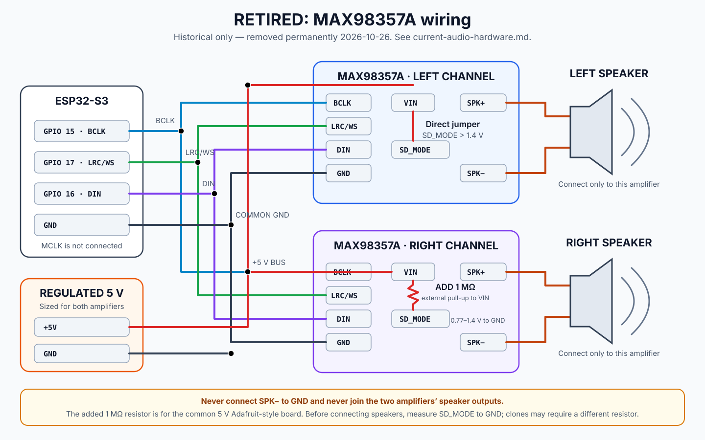

# Radiohead ESP32 Internet Radio

PlatformIO firmware for an ESP32-S3 internet radio with a TFT display, web controls,
station playlists, podcasts, weather, alarms, audio settings, and OTA updates.

## Application layout

- `src/main.cpp` coordinates startup and the main device loop.
- `src/app_state.cpp` owns shared hardware objects and application state.
- `src/media.cpp` handles stations, M3U playlists, podcasts, and audio metadata.
- `src/settings.cpp` persists user configuration with `Preferences`.
- `src/display.cpp` owns colors, weather rendering, Wi-Fi status, spectrum, and VU drawing.
- `src/device_control.cpp` handles the encoder task, sleep, and factory reset.
- `src/web_server.cpp` owns web pages, request validation, routes, uploads, and OTA handling.
- `include/` contains the public interface for each module.

The bundled `lib/ESP32-audioI2S-master` directory is third-party code and remains
separate from the application modules.

The [framework consolidation plan](docs/framework-consolidation-plan.md) recommends
one authoritative ESP-IDF build, retaining Arduino as a component. Implementation
and device validation of that consolidation are pending.

## Encoder wiring and controls

The radio has **one physical button: the encoder's push switch**. Disconnect power
before wiring. These are ESP32-S3 GPIO numbers, not physical header positions.

| Encoder module pin | ESP32-S3 connection |
| --- | --- |
| `+` / `VCC` | **3.3 V**, not 5 V |
| `GND` | Common GND |
| `CLK` / `A` | GPIO 4 (`PIN_A`) |
| `DT` / `B` | GPIO 7 (`PIN_B`) |
| `SW` | GPIO 13 (`PIN_SW`) |

Encoder modules may pull their signal pins up to VCC. Use 3.3 V so these signals
stay within the ESP32-S3's input limits; its GPIOs are not 5 V tolerant. See the
[Espressif datasheet](https://documentation.espressif.com/esp32_s3_datasheet_en.pdf).
A bare mechanical encoder needs no VCC connection: connect its rotary common and
one switch contact to GND, A/B to GPIO 4/7, and the other switch contact to GPIO 13.
The firmware enables internal pull-ups.

GPIO 35–37 are reserved for octal PSRAM on the configured N16R8 target.
The encoder avoids external JTAG GPIO 39/40 and possible RGB LED GPIO 38.
The owner's board is labelled YD-ESP32-23 2022-V1.3; the
[published YD design](https://github.com/vcc-gnd/YD-ESP32-S3#readme)
uses GPIO 48 for its RGB LED. Board metadata remains the N16R8 build target.
See [Espressif's board pin restrictions](https://docs.espressif.com/projects/esp-dev-kits/en/latest/esp32s3/esp32-s3-devkitc-1/user_guide_v1.1.html).

- Turn to change volume; short-click to mute/unmute.
- Hold the switch while powering on or resetting to request Wi-Fi setup/recovery.
  Boot checks for a pressed switch, without a timed hold threshold. Release after
  setup mode starts. This does not start touch calibration.
- During normal operation, a hold of 3 seconds requests light sleep; another
  encoder press wakes the radio.

Leave GPIO 6 (`PIN_K0`) disconnected for this one-button wiring. If retaining
a separate K0 button, keep it on GPIO 6; its sleep/factory-reset handler and
light-sleep wake remain active. Do not bridge GPIO 6 and 13. Sleep consumes
the initiating and waking button releases before restarting normal startup.

Pin remap, 2026-10-13: with power disconnected, move encoder A from 39 to 4,
B from 40 to 7, SW from 38 to 13, and TFT backlight control from 3 to 1.
Touch T_CLK/T_DIN must already be on shared SPI GPIO 12/11, not the previous
separate-bus GPIO 4/7. Rewire all four connections before using this image.
Hardware acceptance of the remap remains pending.

The future [battery power plan](docs/hardware/battery-power-architecture-plan.md)
also uses this one switch and GPIO 13, through an adapted BSS138 interface to the
IP5310 KEY input. It replaces the relay proposal. That circuit requires different
switch wiring and bench validation; its software shutdown sequence is not yet
implemented.

## Stereo speakers

The firmware already sends stereo audio on the I2S bus. Two mono MAX98357A
amplifiers share the same BCLK, LRC/WS, and DIN signals; their `SD_MODE` wiring
selects left or right audio.

With power disconnected, wire the two MAX98357A boards as follows:

| Connection | Left amplifier | Right amplifier |
| --- | --- | --- |
| Regulated 5 V supply | `VIN` | `VIN` |
| Common GND with ESP32-S3 | `GND` | `GND` |
| GPIO 39 (`I2S_BCK`) | `BCLK` | `BCLK` |
| GPIO 41 (`I2S_LRC`) | `LRC` / `WS` | `LRC` / `WS` |
| GPIO 40 (`I2S_DIN`, ESP32 data output) | `DIN` | `DIN` |
| Gain selection | Leave `GAIN` unconnected | Leave `GAIN` unconnected |
| Speaker terminals | Left speaker to this board's `SPK+` / `SPK-` | Right speaker to this board's `SPK+` / `SPK-` |

The amps accept the ESP32's 3.3 V I2S signals while powered from 5 V. No MCLK is
needed. Use a supply and wiring sized for both amps plus the radio, and keep I2S
wires short. Use speakers rated at least 4 ohms with a suitable power rating.
Unconnected `GAIN` selects the default 9 dB gain. See the
[Adafruit MAX98357A pinout guide](https://learn.adafruit.com/adafruit-max98357-i2s-class-d-mono-amp/pinouts).

For common **Adafruit-style boards powered at 5 V**:

- Left amp: connect `SD` / `SD_MODE` directly to its `VIN`.
- Right amp: connect `SD` / `SD_MODE` to its `VIN` through an **additional 1 MΩ
  resistor**, retaining the board's existing pull-up.

Before attaching speakers, measure `SD` to GND: left must be above 1.4 V; right
must be between 0.77 and 1.4 V. Clone pull-ups can differ, so choose the resistor
for the measured voltage if needed. Then test channel separation at low volume
using known left/right audio. Electrical and playback checks remain on-device
verification; this table does not claim they have been performed.



The diagram shows the additional 1 MΩ pull-up used to select the right channel on
the common 5 V Adafruit-style board. See the
[MAX98357A stereo wiring notes](docs/hardware/max98357a-stereo.md) before connecting
the second amplifier or using a different breakout. The speaker outputs are
bridge-tied and must not be connected together or to ground.

## PCM5102A DAC + XH-A244 amplifier wiring

This alternative replaces **both MAX98357A boards** with one stereo PCM5102A
DAC and one XH-A244 amplifier. Disconnect all power before rewiring. The sketch
matches the **back of the owner's red PCM5102 board**, photographed 2026-10-25:
six holes across the top, nine down the left, and the audio jack on the right.
Follow the printed labels when turning the board over; the view will be mirrored.

```text
                    PCM5102A — BACK VIEW, as in the photo
                  +---------------------------------------+
Top header:       |  o     o     o     o      o      o     |
                  | SCK   BCK   DIN   LRCK   GND    VIN    |
                  |                                       |
Left edge:        | o FLT     [solder configuration pads]   |
                  | o DEMP                                |
                  | o XSMT                                |
                  | o FMT                                 |
                  | o A3V3                                |
                  | o AGND                                |
                  | o ROUT                         [audio |
                  | o AGND                           jack]|
                  | o LROUT                               |
                  +---------------------------------------+

ESP32-S3 / supply             PCM5102A TOP HEADER
GND ------------------------ SCK     (master clock tied low)
GPIO 39 -------------------- BCK     (bit clock)
GPIO 40 -------------------- DIN     (audio data into DAC)
GPIO 41 -------------------- LRCK    (left/right clock)
GND ------------------------ GND
Verified module supply ----- VIN     (see power note below)

PCM5102A LEFT EDGE           XH-A244 ANALOG AUDIO INPUT
LROUT ---------------------- L / IN-L
ROUT ----------------------- R / IN-R
AGND ----------------------- GND     (either AGND hole)

12 V supply + -------------- XH-A244 DC+ / VCC
12 V supply - -------------- XH-A244 DC- / power GND
                                  |
ESP32 GND + DAC GND ---------------+  common ground

XH-A244 SPEAKER OUTPUTS
L+ ------------------------- Left Dayton PC83-4 +
L- ------------------------- Left Dayton PC83-4 -
R+ ------------------------- Right Dayton PC83-4 +
R- ------------------------- Right Dayton PC83-4 -
```

The GPIO assignments match [include/app_audio_pins.h](include/app_audio_pins.h).
`SCK` is **not** `BCK`: ground `SCK`, and connect only `BCK` to GPIO 39.
The bottom label **`LROUT` means the left analog output** on this board layout;
use it together with `ROUT` for stereo. Do not connect the old MAX speaker outputs
to the new amplifier's input. The amplifier labels above describe function, not
physical terminal order; its connector layout has not been photographed.

**DAC power still needs confirmation from the component side or its seller's
schematic.** The back photo shows `VIN` and `A3V3`, but does not establish the
regulator or VIN rating. If this is the usual regulated **5 V VIN** version,
connect the radio's regulated 5 V supply to `VIN`. Do not apply 5 V on that
assumption alone. Leave `A3V3` externally unconnected in this VIN-powered setup;
it is the analog 3.3 V rail, not a second VIN. Never apply 12 V to any DAC or ESP32
pin. Keep the ESP32 on its existing supply.

### PCM5102A configuration pads

These four left-edge control pins are normally configured by the board's solder
jumpers, so they need **no additional ESP32 GPIO wires** when set correctly:

| Printed control pin | Required state | Purpose |
| --- | --- | --- |
| `FLT` | Low / GND | Normal-latency filter |
| `DEMP` | Low / GND | De-emphasis off |
| `XSMT` | High / digital 3.3 V | Unmuted output |
| `FMT` | Low / GND | Philips I2S format |

Solder is visible on the photographed pads, but the selected bridges are not
confirmed. With power off, identify which jumper center is connected to each
control pin and which outer pad is GND or digital 3.3 V using continuity and the
board schematic. If a jumper must change, remove the old bridge before joining
the center to the required side. Never bridge both sides or wire `XSMT` to 3.3 V
while its jumper shorts it to GND. After confirming VIN and powering only the
DAC/radio, check the four control voltages relative to GND before connecting the
amplifier. The chip's pin functions and three-wire clock mode are documented in
the [TI PCM5102A datasheet](https://www.ti.com/lit/ds/symlink/pcm5102a.pdf).

Keep I2S wires short and route ground alongside them. Run the amplifier's power
return directly to its 12 V supply, not through the DAC's thin ground wire.
Connect one 4-ohm Dayton PC83-4 per channel. **Neither speaker negative is ground;
do not join the speaker negatives.** These are bridge-tied outputs on the
[TPA3110D2](https://www.ti.com/product/TPA3110D2).

Start with low volume and flat bass EQ, then check left/right separation with
known stereo audio. No firmware edit is made for this wiring; compatibility,
startup/mute behavior, noise and playback still require on-device verification.

## Build

```sh
python3 tools/build_firmware.py
# Equivalent PlatformIO convenience target:
pio run -e esp32s3
```

The complete firmware is compiled once through ESP-IDF 5.5.5 / CMake, with
Arduino-ESP32 3.3.11 as a component and Spotify included. PlatformIO installs
the pinned toolchain and libraries; it does not compile a second application.
The entry command also prepares the pinned cspot/Bell candidate and generates
UI assets. Asset generation currently requires macOS `sips`, `xxd`, and Swift.
Python 3, PlatformIO and Git must be installed; the first build needs network
access for dependencies. Framework updates remain a separate change.

The OTA application stays at `.pio/build/esp32s3/firmware.bin`. Matching factory,
ELF, bootloader, partition and initial OTA images plus `artifacts.json` are
exported from the same native build. Flash an existing build with:

```sh
~/.platformio/penv/bin/python tools/flash_built_firmware.py --port /dev/cu.usbmodem11201
```

`pio run -e esp32s3 -t upload` builds then uses the same validated uploader.
It writes the bootloader, partition table, initial OTA selection and app0,
preserving NVS, LittleFS and app1. `--dry-run` prints that command without
opening the serial port. `pio run -e esp32s3 -t clean` removes the default native
build and exported artifacts. Use a fresh `--build-dir` after changing component
paths or configuration defaults; `--output-dir` can isolate comparison artifacts.
See the [consolidation verification record](docs/framework-consolidation-validation.md)
for build evidence, baseline recovery artifacts and pending physical-device checks.

## Back up and restore settings

Export saved settings to `radiohead-settings.rhb` in your Downloads folder:

```sh
curl -f --connect-timeout 5 --max-time 20 \
  -H 'X-Radiohead-Backup: 1' \
  http://192.168.11.127/api/settings/backup \
  -o "$HOME/Downloads/radiohead-settings.rhb"
```

Upload that file to replace the saved settings and restart the radio:

```sh
curl -f --connect-timeout 5 --max-time 20 \
  -H 'X-Radiohead-Backup: 1' \
  -F "backup=@$HOME/Downloads/radiohead-settings.rhb" \
  http://192.168.11.127/api/settings/restore
```

Replace `192.168.11.127` with the radio's displayed IP address if it changes.
The download command saves to the file rather than displaying its contents.
Backups include credentials, stations, programs, favorites and touch calibration;
station artwork is excluded. Keep the file private and power connected during
restore. A successful restore returns `{"restored":true,"restarting":true}`;
the radio then reconnects using the restored Wi-Fi settings. See the
[settings backup API](docs/settings-backup.md) for coverage and recovery details.

## Switch boot screens over HTTP

Both screens are included in the firmware. The selection is stored on the device
and takes effect after restart. Mode `0` is the original screen; mode `1` is the
new artwork and the default.

Select the original screen:

```sh
curl -X POST http://radio.local/api/device/boot-mode \
  -H 'X-Radiohead-Config: 1' --data 'mode=0'
```

Select the new screen:

```sh
curl -X POST http://radio.local/api/device/boot-mode \
  -H 'X-Radiohead-Config: 1' --data 'mode=1'
```

After a successful save, restart to apply it (playback stops during reboot):

```sh
curl -X POST http://radio.local/api/device/restart
```

Check the active and saved modes with
`curl http://radio.local/api/device/boot-mode`. If `radio.local` does not resolve,
replace it with the radio's displayed IP address. See
[persisted boot modes](docs/boot-modes.md) for response fields and reset behavior.

## TFT display and touch wiring

The firmware uses a **240 × 320 ILI9341 SPI TFT with an XPT2046 resistive-touch
controller**, displayed in **320 × 240 landscape** orientation. The connections below
match the pin constants in [include/app_state.h](include/app_state.h) and the
LovyanGFX configuration in [src/app_state.cpp](src/app_state.cpp). Numbers refer to
ESP32-S3 **GPIO numbers**, not physical header positions. The table records the
shared-bus wiring in the actual TFT header order; hardware verification
of this change remains pending.

The **two joined pairs** are:

| Pins joined on the TFT module | ESP32-S3 connection |
| --- | --- |
| `SCK` + `T_CLK` | GPIO **12** |
| `SDI(MOSI)` + `T_DIN` | GPIO **11** |

Disconnect power before wiring. This device's TFT `VCC` is connected to **5 V DC**;
its signal connections use **3.3 V logic**. Display, touch controller, ESP32-S3, and
audio hardware share a common ground. The pin order matches the
[LCDWIKI MSP2807 interface](https://www.lcdwiki.com/2.8inch_SPI_Module_ILI9341_SKU:MSP2807),
which specifies 3.3–5 V power, 3.3 V logic, and optional display `SDO`. The exact
module model has not been confirmed, so verify the supply rating before using this
wiring with a replacement panel. A 5 V module supply does not mean 5 V GPIO signals.
ESP32-S3 electrical limits are documented in the
[Espressif datasheet](https://documentation.espressif.com/esp32_s3_datasheet_en.pdf).

### Complete header wiring, in pin order

Read the labels printed on the TFT module: this numbering starts at `VCC` and
ends at `T_IRQ`. Viewing the header from the opposite side reverses its apparent
left-to-right order; match labels rather than counting from a viewing direction.

| Header position | TFT module pin | ESP32-S3 connection | Function |
| ---: | --- | --- | --- |
| 1 | `VCC` | 5 V DC supply | Module power; owner's working connection |
| 2 | `GND` | `GND` | Common ground |
| 3 | `CS` | GPIO 8 | Display chip select (`TFT_CS`) |
| 4 | `RESET` | GPIO 10 | Display reset (`TFT_RST`) |
| 5 | `DC` | GPIO 9 | Data/command select (`TFT_DC`) |
| 6 | `SDI(MOSI)` | GPIO 11, joined to `T_DIN` | Shared SPI2 data from ESP32-S3 (`TFT_MOSI`) |
| 7 | `SCK` | GPIO 12, joined to `T_CLK` | Shared SPI2 clock (`TFT_SCLK`) |
| 8 | `LED` | GPIO 1 | Backlight PWM (`TFT_BLK`); remapped from GPIO 3 |
| 9 | `SDO(MISO)` | **Not connected** | Display readback; not needed by the current application |
| 10 | `T_CLK` | GPIO 12, joined to `SCK` | Shared SPI2 touch clock (`TOUCH_SCLK`) |
| 11 | `T_CS` | GPIO 14 | Separate touch chip select (`TOUCH_CS`) |
| 12 | `T_DIN` | GPIO 11, joined to `SDI(MOSI)` | Shared SPI2 touch data in (`TOUCH_MOSI`) |
| 13 | `T_DO` | GPIO 5 | Touch data out to ESP32-S3 (`TOUCH_MISO`) |
| 14 | `T_IRQ` | **Not connected** | Touch interrupt; firmware uses polling |

The shared bus uses GPIO 5 for MISO, connected only to touch `T_DO`.
GPIO 13 is the encoder switch. Display `SDO(MISO)` remains disconnected.
Current display rendering does not read pixels or registers back from the physical TFT; pixel
reads in the renderer use its in-memory canvas. Keep `T_DO` connected for touch
to work.

The firmware drives GPIO 1 with active-high, 5 kHz PWM for brightness, automatic
dimming, and backlight shutdown during sleep. Connect it directly only if the module
provides a 3.3 V compatible backlight control input. If `LED` is a backlight power
terminal, use an appropriate current-limited LED driver with an active-high PWM
input driven by GPIO 1; do not assume a GPIO can supply the backlight current.
Backlight pin circuitry varies by breakout; for example, Adafruit documents a PWM
control input on its
[ILI9341 breakout](https://learn.adafruit.com/adafruit-2-4-color-tft-touchscreen-breakout/pinouts).
Tying the backlight permanently to the supply bypasses firmware dimming and shutdown.

The TFT and touch share SPI2 clock/data lines; touch runs at 1 MHz with its own
chip select. With power disconnected, join SCK/T_CLK to GPIO 12 and
SDI/T_DIN to GPIO 11. Keep touch T_DO on GPIO 5:

```text
ESP32-S3 GPIO 12 ──┬── TFT SCK
                  └── Touch T_CLK
ESP32-S3 GPIO 11 ──┬── TFT SDI (MOSI)
                  └── Touch T_DIN
ESP32-S3 GPIO  8 ───── TFT CS
ESP32-S3 GPIO  9 ───── TFT DC
ESP32-S3 GPIO 10 ───── TFT RESET
ESP32-S3 GPIO  1 ───── TFT LED / backlight control
ESP32-S3 GPIO  5 ───── Touch T_DO
ESP32-S3 GPIO 14 ───── Touch T_CS
TFT SDO (MISO)  ────── Not connected
Touch T_IRQ     ────── Not connected
```

Encoder A/B/switch use GPIO 4/7/13. GPIO 3/38/39/40 are no longer used by
the radio's peripheral wiring.
See [the TFT/touch wiring guide](docs/hardware/touch-spi-wiring.md).
The shared-bus firmware passed `pio run -e esp32s3`,
`python3 tools/check_touch_diagnostics.py` and `git diff --check` on 2026-10-13.
The shared-bus change has not been flashed or verified on hardware.

Keep `CS` and `T_CS` separate. Pins on a module's optional microSD connector
(`SD_CS`, `SD_SCK`, `SD_MOSI`, `SD_MISO`) are not used by this firmware and should
be left unconnected. `SDI` and `SDO` in the display table are TFT data pins, not
microSD connections. This wiring requires an SPI display and XPT2046 controller;
raw resistive-touch terminals (`X+`, `X-`, `Y+`, `Y-`) are not substitutes for the
`T_*` pins.

### Simple TFT color test

For a lit backlight with no picture, enable the optional
[TFT color test](experiments/tft-color-test/README.md). It cycles solid red, green,
blue, white and black once per second, using the existing TFT pins at 8 MHz
without touch, Wi-Fi, audio or the radio UI:

```sh
python3 tools/build_firmware.py --tft-color-test
~/.platformio/penv/bin/python tools/flash_built_firmware.py \
  --artifacts-dir .pio/build/tft-color-test --port /dev/cu.usbmodem11201
```

The flag sets `RADIOHEAD_TFT_COLOR_TEST=ON` for CMake and compiles only the
screen diagnostic entry points. It defaults to OFF; ordinary builds run the
radio. Test builds use `.pio/idf-tft-color-test` and `.pio/build/tft-color-test`,
preserving the normal radio artifacts. Use your radio's actual port. Uploading
the test replaces the running application temporarily; the test guide includes
the command to restore the radio firmware.
The original standalone color test was uploaded successfully on 2026-10-11
with verified flash hashes, then normal radio firmware was restored. The native
flag-enabled diagnostic is build-verified; its screen output still needs visual
confirmation. It contains no boot audio.

### Touch calibration and diagnostics

On the radio, open **Settings → Device → Touch calibration**, then tap and release
each of the four corner markers. The raw coordinates are printed at 115200 baud and
saved in NVS, then loaded automatically on later boots. Without saved calibration,
the firmware uses its default touch mapping. Repeat calibration after replacing or
rotating the screen.

Normal firmware polls touch but leaves diagnostic output disabled.

### Low-sensitivity test

Verify the new wiring above before sensitivity testing. There is no established sensitivity
benefit from connecting display `SDO` or touch `T_IRQ`: the former supplies display
readback, and the latter is unused by the current polling implementation. The touch
driver currently uses the stock LovyanGFX XPT2046 reader at 1 MHz, including its
pressure gate. The custom coordinate-only sampler remains in the source but is
inactive. Separating the SPI buses does not establish a sensitivity improvement.

1. Wake the screen and complete calibration if taps land in the wrong place.
2. At the same button, compare 10 comfortable light finger-pad taps with 10 gentle
   fingernail taps. Lift fully for at least half a second between taps. Count attempts
   and actual button actions separately. Repeat at the center and near the edges.
3. If light finger-pad taps fail while fingernail taps work, inspect any removable
   shipping film and whether the enclosure presses on the panel. With power off,
   check touch jumper contacts and shorten unnecessarily long SPI/ground wires.
   Change one thing at a time and repeat the same trial. Do not peel the bonded
   resistive touch layer or press harder to count a light tap as successful.
4. For input-event evidence, see
   [the touch diagnostic capture procedure](docs/ui/touch-diagnosis.md) and enable
   `TOUCH_DEBUG_ENABLED=1` for `Touch polls=` reports. The procedure also covers
   `TouchADC` reports from the custom sampler; those are unavailable with the
   currently active stock reader. These counters describe coordinates and events,
   not measured physical pressure.

The owner confirmed the previous shared-bus wiring worked. Firmware now restores
the clock/data joins while keeping `T_DO` on GPIO 5. This shared-bus change and
comfortable finger-pad sensitivity still require physical trials; no new
electrical measurement is implied by this documentation update.
