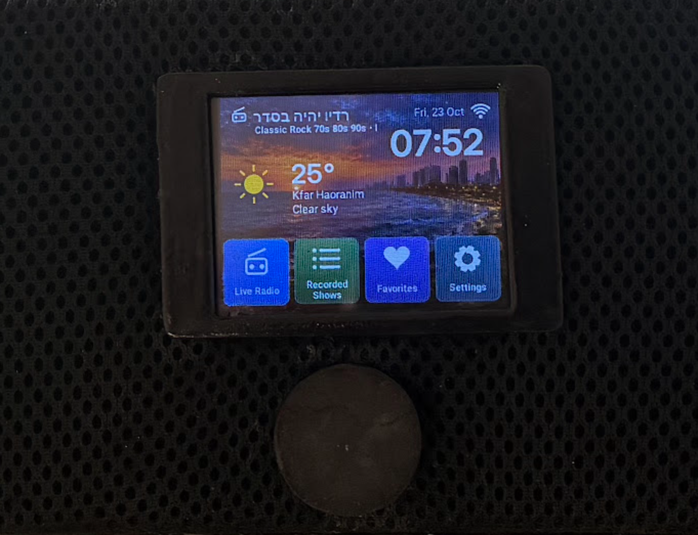
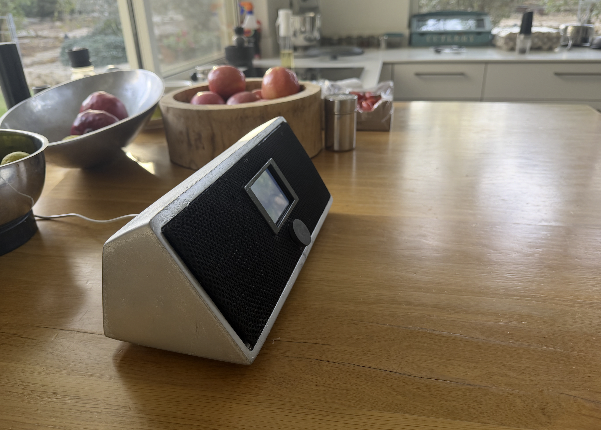
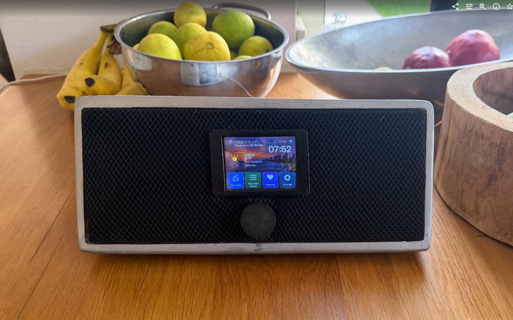
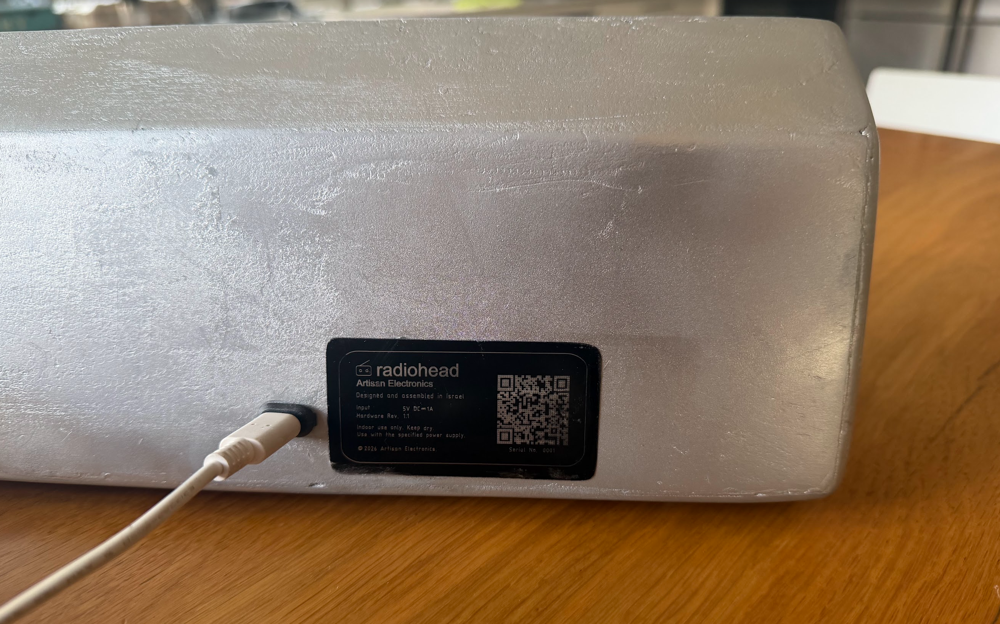

# Radiohead

An ESP32-S3 internet radio with a touchscreen, physical volume control, and a
local web interface for setup and playback control.

<p align="center">
  <a href="docs/images/radio_type1_2.png"></a>
  <a href="docs/images/radio_type1.png"></a>
</p>
<p align="center">
  <a href="docs/images/radio_type1_3.png"></a>
  <a href="docs/images/radio_type1_4.png"></a>
</p>

## Features

- Internet radio stations, favorites, and stream metadata.
- Recorded shows and podcasts from RSS feeds or direct audio URLs.
- Native Spotify Connect playback, included in the default build.
- Touchscreen navigation, station artwork, clock, and weather.
- Rotary encoder for volume, mute, and sleep/wake.
- Web configuration, audio controls, settings backup/restore, and OTA updates.

## Hardware

The current assembly uses an **ESP32-S3 N16R8**, a **2.8-inch ILI9341 TFT** with
XPT2046 resistive touch, and a rotary encoder. Stereo audio runs through a
**PCM5100 DAC → HX-A244 amplifier → speakers**, with an external speaker-mute
circuit controlled by GPIO2.

See the [hardware and wiring guides](docs/README.md#hardware) before assembling
or changing connections.

## Build and flash

The build currently requires **macOS**, Python 3 with Pillow, PlatformIO, Git,
and the `sips`, `xxd`, and Swift tools used to prepare UI assets. The first build
downloads pinned dependencies.

```sh
python3 -m pip install Pillow
pio run -e esp32s3
pio run -e esp32s3 -t upload --upload-port PORT
```

Replace `PORT` with your radio's serial port. The firmware builds once through
ESP-IDF/CMake with Arduino as a component. The OTA image is exported to
`.pio/build/esp32s3/firmware.bin`.

See [building and flashing](docs/building.md) for the direct Python entry point,
uploading an existing build, artifact handling, and clean builds.

## First use

1. Power on the radio. With no saved Wi-Fi credentials, it opens setup mode;
   follow the connection details on the display.
2. Open the displayed address, or `http://radio.local` when connected to your
   network, to configure Wi-Fi, stations, programs, and other settings.
3. Use touch to browse and select content. Turn the encoder to change volume,
   click to mute/unmute, or hold for three seconds to sleep. Press again to wake.

Hold the encoder switch while powering on or resetting to request Wi-Fi
setup/recovery. For Spotify provisioning and playback, use the web interface's
Spotify section.

## Documentation

- [Documentation index](docs/README.md) — wiring, operation, diagnostics, and history.
- [Firmware architecture](docs/firmware-architecture.md) — modules and ownership.
- [Settings backup and restore](docs/settings-backup.md) — API usage and recovery.
- [UI design and implementation](docs/ui/README.md) — specifications and progress.
- [Spotify validation](docs/spotify-validation/progress.md) — integration evidence and remaining checks.

Development and hardware acceptance are tracked in the linked records. Build and
host checks are recorded separately from on-device validation.
